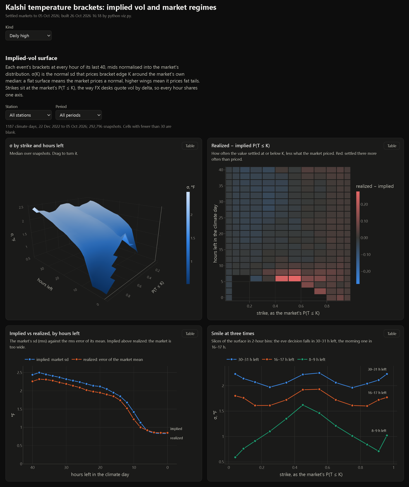
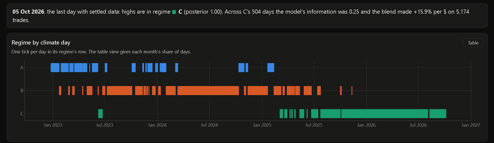
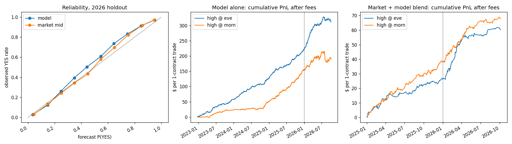

# Kalshi weather

Kalshi runs daily markets on the high and low temperature at US weather stations. Each day is a
ladder of brackets, and each bracket pays $1 if the official reading lands in it. Read together, the
prices are the market's probability distribution for the day's temperature. This repository reads
them the way an options desk reads a vol surface, and tests whether a forecast built from public
weather data can beat them.



**The visualizer runs in the browser: <https://deivid-negoita.github.io/kalshi-weather/>**. It is one
offline page with plotly inlined and no build step. Pick high or low, a station and a period; every
chart has a table view.

What it found:

- **The market prices the day too wide.** At 30 hours out the realized error of its own mean is 6%
  smaller than the spread it prices on highs and 12% smaller on lows. The two only meet in the last
  six hours.
- **Both tails are overpriced.** A day out, the reading lands in a tail 1 to 5 points less often
  than the price pays for.
- **A forecast beat the price, then stopped.** Blended with the market, it made +1 to +4¢ a contract
  in every set of the 2026 holdout. On live quotes from 16 to 26 October it lost 16% of what it
  staked: since July the market's own mean had become the better forecast for highs.
- **The regimes show why.** A three-regime mixture over the market's trailing-week behaviour,
  lettered by when each occurs: the bracket spread falls from 8.4¢ to 2.6¢ across them, and the
  information the model adds from .42 to .25. Every highs day of 2026 is in the last one.

## What is here

| File | Does |
|---|---|
| [`fetch.py`](fetch.py) | Downloads every input from free public APIs: Kalshi markets and hourly bid/ask candles, NWS climate reports, station observations, MOS, NBM and LAMP forecasts, NOAA GHCN, and global model runs. |
| [`model.py`](model.py) | A forecast from NWS data alone, as a full distribution of the integer the climate report will print. No Kalshi data goes in. |
| [`boost.py`](boost.py) | LightGBM that learns `model.py`'s error from the global models, live observations and the mean the market's brackets imply. |
| [`backtest.py`](backtest.py) | Prices every settled bracket against the archived bid and ask, and trades the model alone and a market + model blend, out of sample. |
| [`viz.py`](viz.py) | The implied-vol surface and the market regimes, written to [`results/viz.html`](results/viz.html). |

The live paper-trading loop and the research scripts behind the October post-mortem are not
included.

## The implied-vol surface

- **The data.** Every whole event (a tail at each end, no gaps, every bracket quoted) at each of
  the 40 hours before its climate day ends: 12,765 events, 447,818 snapshots and 1,221,793 bracket
  edges, 22 Dec 2022 to 5 Oct 2026.
- **The inversion.** The bracket mids are normalised into a distribution. At each bracket edge K,
  the market's CDF F gives σ(K) = (K − median) / Φ⁻¹(F): the normal sd that prices that edge. A flat
  surface means the market prices a normal; raised wings mean it prices fat tails.
- **The axis.** Strikes sit at F, the way FX desks quote vol by delta, so every hour shares one
  axis.
- **Beside it:** realized minus implied P(T ≤ K), and the market's sd against the rms error of its
  mean by hours left (implied against realized vol).
- **The check.** `python viz.py check` feeds the inversion a market that prices a normal exactly;
  the surface comes back flat at that sd.

What the surface shows:

- **The market prices too wide until the last hours.** Realized over implied sd:
  - highs: .94 at 30 h and .95 at 16 h (.89 and .93 since July 2026), .86 to .88 at 8 to 10 h
    (.77 to .78 since July), about 1.02 in the last six hours;
  - lows: .88 and .90 at 30 and 16 h (.81 and .86 since July).
- **Both wings are overpriced.** From 16 to 40 h out, realized minus implied P(T ≤ K) is −.02 to −.05
  for F between .06 and .5, and +.01 to +.03 for F above .8. The outcome lands in a tail less often
  than the market pays for. The paper run's YES bets on open-ended brackets bought exactly that side
  and lost $11.57 on 16 trades.
- **One hot spot to ignore.** Highs at 4 to 8 h with F between .4 and .6 read +.25 to +.28, but
  those cells come from 2023 to 2025; since July each holds fewer than 30 snapshots.
- **A lead, untested:** selling the wings a day out. After a ~1.3¢ half-spread and a ~1¢ fee, about
  1 to 2¢ a contract may remain. It needs a walk-forward test before it means anything.

## Market regimes



Each climate day is a point in five trailing-week features known before that day's evening decision:
the market's sd, the bracket spread, |model − market| in market sds, and the settled errors of the
market and of the model, two days back. A three-component Gaussian mixture splits the days, and the
regimes are lettered by when they occur. Each regime is then scored on what its features never see:
the information the model adds, corr(model − market, outcome − market), and the walk-forward blend's
return per dollar.

Highs:

| regime | days | span | spread | model information | model − market MAE | blend trades | return / $ |
|---|---|---|---|---|---|---|---|
| A | 251 | Dec 2022 – Feb 2025 | 8.4¢ | .42 | −0.18 °F | 146 | 22.8% |
| B | 613 | Jan 2023 – Nov 2025 | 6.4¢ | .33 | −0.08 °F | 849 | 15.1% |
| C | 504 | Jun 2023 – Oct 2026 | 2.6¢ | .25 | −0.02 °F | 5,174 | 15.9% |

- **The market learning in slow motion.** Each later regime has a tighter book, a smaller gap
  between model and market, less information and a model lead shrinking from 0.18 to 0.02 °F. Every
  highs day of 2026 is regime C.
- **Why three.** BIC keeps falling past three regimes without an elbow. The page stops at three
  because past that the regime colours stop being told apart under colour blindness.
- **What they cannot do** is date the October break. C pools 2023 to 2026, the data end on 5 Oct,
  and C still returned 15.9% on average.

## Can a forecast beat the price?

### The forecast

`model.py` gives, for each station, high or low, decision time and day, a probability for every
integer the climate report can print, so any bracket can be priced from it. There are two decision
times: 18:00 local standard time the evening before, and 07:00 on the day.

- **The blend.** A linear regression of the truth on the newest NBM, GFS MOS and NAM MOS runs public
  at the decision time plus a seasonal term, refit every month on the three years before it.
- **The calendar day.** MOS forecasts a daytime max and an overnight min, but Kalshi settles on the
  local-standard-time calendar day. When a cold front passes overnight, the day's high is set just
  after midnight; in Austin on 30 Nov 2025 the NBM said 50 °F and the report said 60. So each model's
  max is widened with its own 3-hourly forecast for the hours outside its window, and the min
  likewise.
- **The distribution.** Same-season training errors scaled by NBM's own spread, shrunk and smoothed
  with a kernel. Out of sample (every month from Jan 2020 predicted from earlier data only, all 40
  stations), the 80% intervals cover 80.7 to 81.5%.

`boost.py` learns `model.py`'s error from everything else known at the decision time. That covers
ECMWF IFS, ICON, GEM and GFS runs, the latest station observation, recent bias, the NBM's weather
regime for the day, LAMP, HRRR and the mean the market's brackets imply. It fits one LightGBM per
decision and kind, refit monthly. Out of sample in 2026:

| set | MAE, `model.py` → `boost.py` | log score |
|---|---|---|
| evening high | 1.85 → 1.68 °F | 2.27 → 2.18 |
| evening low | 1.88 → 1.59 °F | 2.29 → 2.14 |
| morning high | 1.66 → 1.44 °F | 2.18 → 2.05 |
| morning low | 1.44 → 0.96 °F | 2.05 → 1.68 |

LAMP, HRRR, the market mean and fresher evening runs came after this table; they took the evening
high to 1.57 °F and the morning low to 0.92.

### The backtest

Every settled bracket is priced from the forecast and compared with the last hourly yes bid and yes
ask at or before the decision, and quotes more than 6 hours old are dropped. It buys YES at the ask
when P − ask − fee > θ, and NO at 1 − bid when bid − P − fee > θ, after Kalshi's fee. θ is chosen on
earlier years, and 2026 is held out: 175,769 market-decisions in all. The t-stats sum PnL by calendar
day, because brackets on one day are not independent.

1. **The model alone had an edge, and the market took it away.** On evening highs at θ 0.05, it made
   +2.9¢ a contract in 2023 (t 2.7), +3.0¢ in 2024 (t 3.2), +1.3¢ in 2025 (t 2.1) and −1.5¢ in 2026
   (t −4.1). Over the same years the mean bracket spread fell from 15.2¢ to 4.9¢.
2. **It still carried information the price lacked.** In a logit of the result on logit(mid) and
   logit(model), with errors clustered by day, the model's 2026 coefficient is 0.25 (t 12.8), and
   0.38 (t 20) with `boost.py`.
3. **So the edge was in correcting the price, not replacing it.** A market + model blend, refit each
   month on earlier months only, on the 2026 holdout at θ 0.05:

| set | NWS-only forecast | `boost.py` forecast |
|---|---|---|
| evening high | +2.3¢, 2,650 trades, t 3.0 | **+3.2¢, 3,606 trades, t 4.3** |
| evening low | +3.0¢, 1,763 trades, t 3.0 | **+4.1¢, 3,308 trades, t 4.9** |
| morning high | −1.7¢, 2,113 trades, t −1.6 | **+1.7¢, 3,279 trades, t 2.1** |
| morning low | −0.1¢, 183 trades, t 0.0 | +1.1¢, 481 trades, t 0.5 |



## Then it traded on paper, and lost

From 16 to 26 October 2026 the blend traded live Kalshi quotes with a virtual bankroll at θ 0.08,
2% of equity per order and at most $20. Kalshi was only read; no order was ever sent.

- **The result.** 83 trades lost $19.88 on $121.88 staked, −16.3% per dollar. Highs lost 30.6% on
  51 trades; lows made 11.8% on 32. Fees were $4.45 of the loss.
- **The cause.** The information the model adds to the market's own mean had been fading since
  July. On evening highs it ran .19 to .41 a quarter in 2023 to 2025, .05 in September 2026 and −.14
  in early October. Refit on the run's own quotes, the model's weight on highs turns negative
  (t −2.4). Where the blend and the market disagreed, the market was right.
- **What changed.** Highs were switched off on 26 October, and a lows-only paper run continues to
  13 November. The surface and the regimes above were built for this post-mortem, and they show
  the same thing: a book that tightened from 8¢ to under 3¢, and a model edge that shrank with it.

## What the backtest cannot see

- **Depth.** The candles are top of book with no size. Capped at what traded within an hour at the
  order's price or better, 44% of contracts fill.
- **Quote timing.** The quote is the close of the hourly candle; it may have moved within the hour.
- **Fills.** Taker only, with no queue position.
- **Researcher degrees of freedom.** The calendar-day fix was found by looking at 2026 misses. It
  improves MAE across the whole 2020 to 2026 test period but was not pre-registered. `boost.py`'s
  width rule was picked on 2022 to 2026 coverage.

Read it as a lead worth testing, not a proven strategy.

## Run

```bash
pip install -r requirements.txt          # tested on Python 3.12
python fetch.py stations                 # Kalshi series -> settlement stations, ~3 min
python fetch.py kalshi                   # every market + hourly candles, ~9 h for the full history
python fetch.py cli asos mos             # IEM: climate reports, observations, MOS/NBM/LAMP
python fetch.py ghcn openmeteo hrrr      # NOAA GHCN-Daily, Open-Meteo previous model runs
python fetch.py status                   # coverage + the settlement cross-check
python model.py                          # ~25 min: data/model/preds.parquet
python boost.py                          # data/model/preds_boost.parquet
python backtest.py                       # results/backtest.png
python backtest.py boost                 # results/backtest_boost.png
python viz.py check                      # the σ inversion on a market that prices a normal exactly
python viz.py                            # ~2 min: results/viz.html
```

`data/` is gitignored; the downloads come to about 1.3 GB. Every step resumes where it stopped.
Kalshi's historical endpoints return 429 above about 5 requests a second, and IEM throttles parallel
clients, so keep the IEM steps to one process.

## Data

| source | what | rows |
|---|---|---|
| Kalshi API | every Climate and Weather market (283,574 in 257 series), and hourly candles with yes bid, yes ask and volume | 4.54M candles, 3.05M on the 55 daily temperature series |
| Iowa Environmental Mesonet | NWS Daily Climate Reports, the settlement truth | 314k |
| Iowa Environmental Mesonet | ASOS observations with the raw METAR | 11.2M |
| Iowa Environmental Mesonet | archived GFS MOS, NAM MOS, NBM and LAMP runs | 33.8M |
| NOAA GHCN-Daily | daily max and min at the same stations | 1.16M |
| Open-Meteo previous runs | GFS, ECMWF IFS, ICON and GEM as forecast 1 and 2 days earlier, and HRRR | 1.67M, plus HRRR |

The 40 stations are every NWS climate station a Kalshi weather series settles on. The climate
report matches Kalshi's own settlement value on 12,738 of 12,753 market-days (99.9%).

Kalshi's data is not redistributed here; `fetch.py` downloads it from the public API. Open-Meteo
data is CC BY 4.0. The code is MIT, see [LICENSE](LICENSE).
